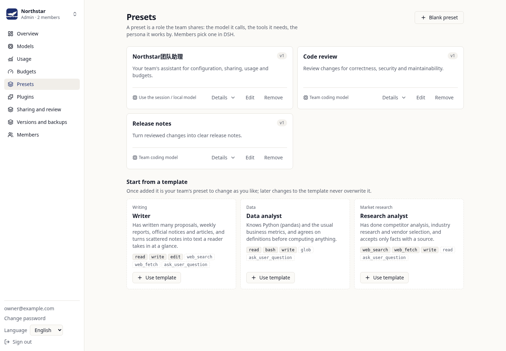
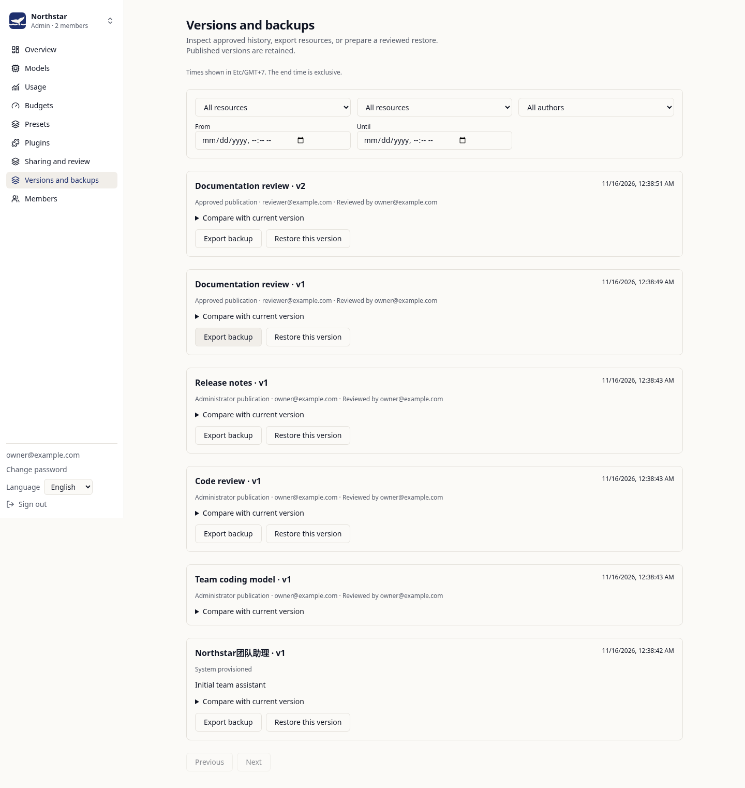

<p align="center"></p>

# DSH Teamwork Platform

English · [简体中文](README.zh-CN.md)

[](https://github.com/dsh-teamwork/dsh-teamwork-platform/actions/workflows/ci.yaml)
[](LICENSE)

**Publish your team's DSH models, presets and plugins from one place.**

This is the open-source community server and web console for
[DSH Teamwork](https://www.dshteamwork.com). Administrators publish shared
resources; members connect through the
[DSH plugin](https://github.com/dsh-teamwork/dsh-teamwork). Team model calls
use the server's gateway, keeping provider keys on the server.



## What your team gets

| Capability | Community edition |
| --- | --- |
| Team resources | Shared models, native agent presets and exact plugin versions, across a person's teams. |
| Team assistant | New teams receive a team-bound assistant; operations follow member/admin permissions and DSH approvals. |
| Team assets | Members publish presets and plugins to the team catalog, and admins choose default versions. |
| Versions and backups | Retained publication history, comparison, resource exports and reviewed restoration. |
| Usage and budgets | Usage reports, model reference prices and team/member/provider limits. Reference points are not a cash wallet. |
| Private plugin storage | Local directory or S3-compatible private storage, authenticated downloads and digest checks. |
| Instance administration | A separate instance-admin role, directories and non-secret diagnostics. |

The console supports English and Simplified Chinese. Screenshots use a local
demonstration team. Publication makes resources available to team members;
it does not install plugins on their computers.

## Choose how to use Teamwork

| Route | Start here |
| --- | --- |
| Hosted service | Open [www.dshteamwork.com](https://www.dshteamwork.com), create/join a team, then install the DSH plugin. |
| Self-hosted community edition | Build this repository with Docker Compose or the source commands below. |
| DSH plugin | Install `@dsh-teamwork/dsh-teamwork` in your DSH host; it connects to either service. |

The hosted relay and matching Teamwork mobile App are separate from this
community server. The hosted service also owns its commercial account/payment
features. Community team configuration, resource review and reference budgets
run without those components.

## Self-host with Docker

Requires Git, Docker and Docker Compose.

```sh
git clone https://github.com/dsh-teamwork/dsh-teamwork-platform.git
cd dsh-teamwork-platform
docker compose up -d --build
docker compose logs server
```

Open the console and create the first account, which its sign-in page offers
until one exists. The local
console is at `http://localhost:3000`; Compose retains the database, secrets and
local plugin archives in its `data` volume. Create a team and add members in
the console.

For access from other computers, set `APP_URL` to your HTTPS origin and put a
TLS proxy in front. In each member's Teamwork sign-in panel, select that server
and authorize DSH. Plain HTTP is accepted by the plugin only on loopback.

The community npm server package and release binaries are not published yet.
Use the source/Compose paths above; the DSH **plugin** is already on npm.
The [self-hosting runbook](docs/ops/self-hosting.md) covers configuration,
storage, first accounts, upgrades, verification and backups.

## Connect DSH and try the assistant

In **DSH Desktop**, open **Plugins → Add plugin**, install
`@dsh-teamwork/dsh-teamwork`, enable it, and follow any restart prompt.
For a **CLI web profile**:

```sh
dsh plugin --profile web add @dsh-teamwork/dsh-teamwork
dsh web
```

Open Teamwork, choose your self-hosted server on the sign-in screen, authorize,
and sync. Select your team's assistant preset and create a session with a
working model. Ask it to inspect team configuration or your usage. New teams
receive the assistant; existing teams are not automatically changed.

Members publish presets and plugins. Administrators manage team defaults,
configuration and budgets, and can restore historical configurations. Provider keys
and initial account passwords use the web console's forms.
See the [plugin user guide](https://github.com/dsh-teamwork/dsh-teamwork/blob/main/docs/en/guide.md)
for commands and local approval behavior.

## Data and administration

- The Go binary serves the API, console, model gateway and instance-management
  console. SQLite is the local default; Postgres and MySQL are supported.
- Provider keys are encrypted under the server's provider-key secret. Team
  prompts and model context pass through the gateway to the configured provider.
- Keep database, private plugin bytes and generated secrets together in an
  operator backup. Resource exports do not replace a full server backup.
- An instance administrator is an explicit `ADMIN_EMAILS` entry, independent
  of team membership; open `/manage` with an allowlisted account. `SERVICE_ROLE` supports combined, user or management
  processes. Separate package-serving processes need the same retained bytes.

Private archives use `teams/{teamId}/plugins/{packageId}.tgz` in either store.
Startup verifies and copies referenced flat objects before a member process
serves, retaining the originals; `--migrate-artifact-paths` runs this pass offline.
See [storage migration](docs/tech/team-assistant.md#private-plugin-packages)
before an upgrade or rollback.

[Documentation](docs/README.md) explains architecture, team resource contracts,
usage accounting, storage and administration.



## Build from source and contribute

Use the repository's Node version (`.nvmrc`), pnpm 10.18.1 and the Go version in
`server/go.mod`:

```sh
pnpm install --frozen-lockfile
pnpm build
./server/dist/dsh-teamwork
```

The local default is `http://127.0.0.1:3800`, with private data in
`~/.dsh-teamwork`. Open it to create the
first account. [CLAUDE.md](CLAUDE.md) contains development commands and the complete
pre-push gate. Pull requests run that gate; commits carry a `Signed-off-by:`
line (`git commit -s`) certifying the [DCO](https://developercertificate.org/).
[Report issues here](https://github.com/dsh-teamwork/dsh-teamwork-platform/issues).

## License

[Apache License 2.0](LICENSE). The DSH Teamwork name and whale mark are covered
by [NOTICE](NOTICE); a fork uses its own branding. A directory with its own
license is covered by that file.
