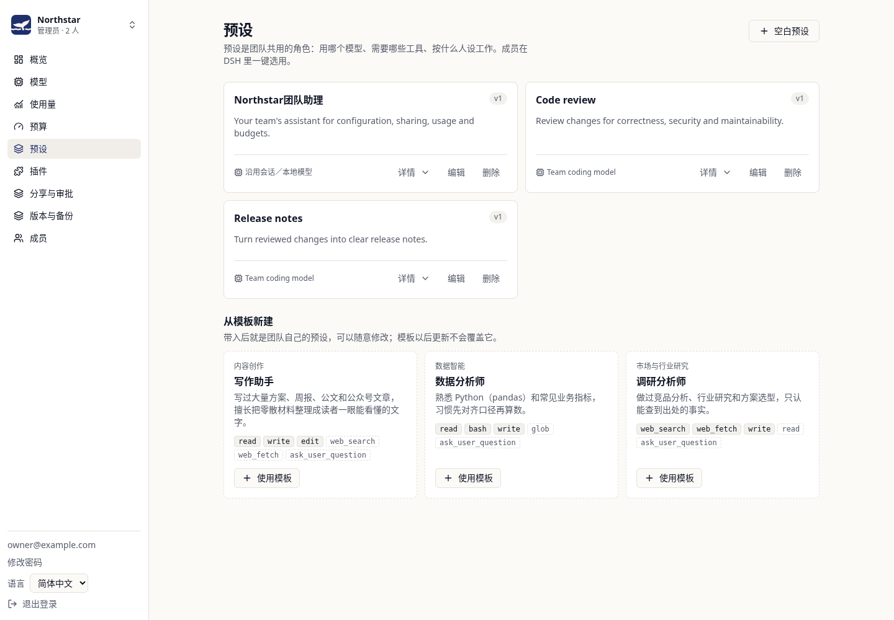
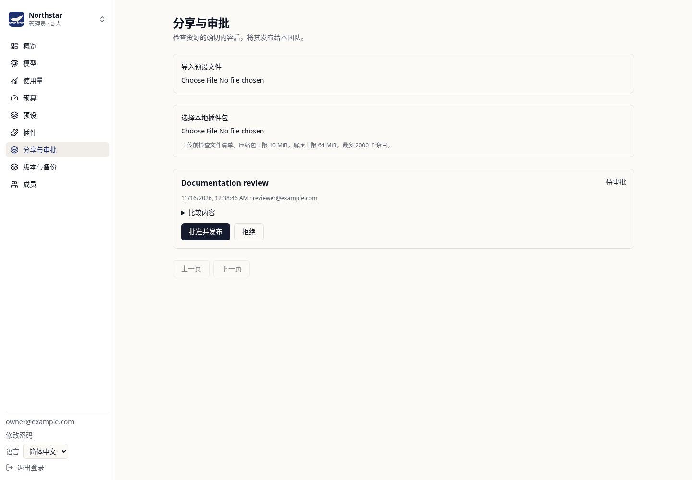
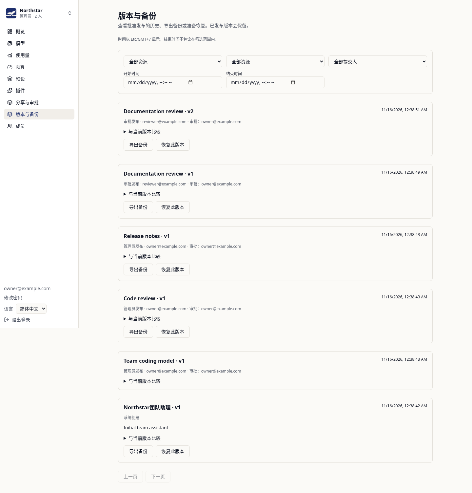

<p align="center"></p>

# DSH Teamwork Platform

[English](README.md) · 简体中文

[](https://github.com/dsh-teamwork/dsh-teamwork-platform/actions/workflows/ci.yaml)
[](LICENSE)

**集中发布团队的 DSH 模型、预设和审批后的插件。**

这里是 [DSH Teamwork](https://www.dshteamwork.com) 的开源社区版服务器与网页控制台。管理员发布共享资源，成员通过 [DSH 插件](https://github.com/dsh-teamwork/dsh-teamwork)连接。团队模型经过服务端网关调用，供应商密钥保留在服务器上。



## 团队可以使用的功能

| 能力 | 社区版提供的功能 |
| --- | --- |
| 团队资源 | 共享模型、原生智能体预设和精确插件版本；一个人可以加入多个团队。 |
| 团队助理 | 新团队带有绑定该团队的助理，操作受成员／管理员权限及 DSH 审批约束。 |
| 分享与审批 | 成员提交新增和更新，管理员检查冻结内容后发布。 |
| 版本与备份 | 保留发布历史，支持对比、资源导出及经审批的历史恢复。 |
| 使用量与预算 | 使用量报表、模型参考价格，以及团队／成员／供应商限额；参考积分不是现金钱包。 |
| 私有插件存储 | 本地目录或兼容 S3 的私有存储、认证下载与摘要校验。 |
| 实例管理 | 独立的实例管理员角色、目录和不含秘密值的诊断。 |

网页控制台支持英文和简体中文，截图来自本地演示团队。发布使资源可供团队成员使用，不会自动在成员电脑上安装插件。

## 选择使用方式

| 方式 | 从这里开始 |
| --- | --- |
| 托管服务 | 打开 [www.dshteamwork.com](https://www.dshteamwork.com)，创建／加入团队，再安装 DSH 插件。 |
| 自建社区版 | 使用下面的 Docker Compose 或源码构建方式运行本仓库。 |
| DSH 插件 | 在 DSH 宿主中安装 `@dsh-teamwork/dsh-teamwork`，可连接托管或自建服务。 |

托管中转和匹配的 Teamwork 手机 App 不属于社区版服务器。托管服务另有商业账号／支付功能；社区版的团队配置、资源审批及参考预算不依赖这些组件。

## 使用 Docker 自建

需要 Git、Docker 和 Docker Compose。

```sh
git clone https://github.com/dsh-teamwork/dsh-teamwork-platform.git
cd dsh-teamwork-platform
docker compose up -d --build
docker compose logs server
```

打开服务器输出的首个账号设置链接，不公开分享该链接。默认本地控制台为 `http://localhost:3000`；Compose 的 `data` 卷保留数据库、密钥和本地插件包。在控制台创建团队并添加成员。

供其他电脑访问时，将 `APP_URL` 设置为实际 HTTPS 地址并部署 TLS 反向代理。成员在 Teamwork 登录面板选择该服务器，再授权 DSH。插件只在本机回环地址上接受明文 HTTP。

社区版服务端的 npm 包和发行二进制尚未发布，请使用源码／Compose；DSH **插件**已发布到 npm。[自建运维指南](docs/ops/self-hosting.md)（英文）涵盖配置、存储、首个账号、升级、验证和备份。

## 连接 DSH 并使用助理

**DSH 桌面版：**在应用内 **Plugins → Add plugin（插件 → 添加插件）** 安装 `@dsh-teamwork/dsh-teamwork`，启用并按提示重启。

**CLI web profile：**

```sh
dsh plugin --profile web add @dsh-teamwork/dsh-teamwork
dsh web
```

在 Teamwork 登录面板选择自建服务器，授权并同步。选择团队助理预设，用可用模型新建会话，要求它查询团队配置或个人使用量。新团队会获得助理，已有团队不会被自动补建。

成员可提交预设／插件；管理员可审核、管理配置和预算，并准备历史恢复。供应商密钥和初始账号密码使用网页安全表单输入。命令和本机审批行为见[插件使用指南](https://github.com/dsh-teamwork/dsh-teamwork/blob/main/docs/zh-CN/guide.md)。



## 数据与管理

- 一个 Go 程序提供 API、控制台、模型网关和实例管理控制台。本地默认 SQLite，也支持 Postgres 和 MySQL。
- 供应商密钥通过服务端密钥加密保存；团队提示词和模型上下文经过网关发送给配置的供应商。
- 完整运维备份需包含数据库、私有插件文件和生成的密钥。资源导出不能替代完整服务器备份。
- 实例管理员由 `ADMIN_EMAILS` 明确指定，与团队成员身份独立。`SERVICE_ROLE` 支持合并、用户和管理进程；提供插件文件的多个进程需要访问同一份保留数据。

[文档索引](docs/README.md)（英文）提供架构、团队资源契约、使用量核算、存储和管理说明。



## 从源码构建与贡献

使用 `.nvmrc` 中的 Node 版本、pnpm 10.18.1，以及 `server/go.mod` 中的 Go 版本：

```sh
pnpm install --frozen-lockfile
pnpm build
./server/dist/dsh-teamwork --data ./local-data
```

本地默认地址为 `http://127.0.0.1:3800`，启动后按照输出链接创建首个账号。[CLAUDE.md](CLAUDE.md)（英文）包含开发命令和完整推送前检查。PR 会运行这些检查；提交使用 `git commit -s` 加入 `Signed-off-by:`，确认 [DCO](https://developercertificate.org/)。问题反馈到 [Issues](https://github.com/dsh-teamwork/dsh-teamwork-platform/issues)。

## 许可证

[Apache License 2.0](LICENSE)。DSH Teamwork 名称和鲸鱼标识另受 [NOTICE](NOTICE) 约束，分叉项目应使用自己的品牌。带独立许可证的目录以其文件为准。
