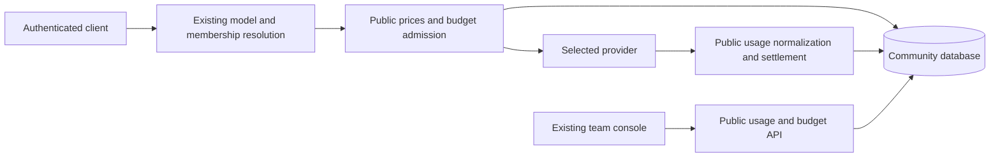

# Usage points and team budgets

> **Status:** Plan — metering and reference-price slice implemented; budget enforcement pending · **Updated:** 2026-11-14

Give a self-hosted team reliable model usage, point prices and enforceable
team/member budgets, with no hosted-service dependency, as decided in
[ADR 0015](../adr/0015-community-usage-and-budgets.md).

## Scope and location

The community edition owns JSON/SSE usage normalization, model reference
prices, points, team/member/provider limits, reservations, daily/monthly
windows, reports, exports, in-app alerts and optional SMTP notifications.
Token caps, request/output bounds, rate limits and concurrent-call controls
apply alongside points. Weekly/lifetime enforcement can follow later.

Implement one service under `server/internal/usage`, with separate files for
normalization, prices, admission, budgets, settlement, HTTP and background
work. Use existing ent schemas/migrations, SQLite/Postgres/MySQL, the team
API and `apps/console`; do not add a service, license check, hosted API or
Redis dependency. Introduce tables only in the slice that consumes them.

The closed edition, where present, adds a hosted wallet/payment participant
through `server/edition`. No public source imports a closed package. An
ordinary BYOK request never needs hosted credit. Optional monetary wallet
settlement must not replace the public budget engine.

Existing instances receive no arbitrary new cap: enforce the policies an
admin configures. Show clearly whether each route is priced and each scope
is limited. Missing prices are not equivalent to zero-cost use.

## Prices, points and usage facts

Each effective model has immutable reference-price versions: uncached input,
cache read/write where billable, and billable output including reasoning
according to supplier semantics. Support provider templates confirmed by the
admin and custom contract prices. Distinguish cost-based reference pricing
from a deliberately configured internal usage weight. No background template
update silently reprices the team's calls.

The reference scale is `1 CNY = 1,000 points` (ADR 0016), with integer internal
units: `1 point = 1,000,000,000 units`. CNY-per-million-token rates with up to
six decimal places convert exactly to units per token. Reject excess precision
and check integer overflow. This scale is an internal reference valuation; it does
not give a community instance a cash wallet. Preserve input currency and
reference FX when converting foreign supplier quotes.

For disjoint token buckets, usage points are the sum of `tokens * units_per_token`
divided by units per point for display. Cached/reasoning counts already in a
total must not be charged twice. Accept decimal strings; return large unit
integers as JSON strings. Never round individual stream chunks or use floating
point for budgets. An explicitly configured zero rate is different from an
unknown price. Unpriced routes cannot pass a points hard cap; supported
token-only controls remain possible.

Keep raw/normalized token counts, normalizer version, provider request id,
effective and submitted config ids, authenticated team/user, immutable rate
snapshot, route identity, policy windows and settlement status. Preserve
pricing provenance (team or extension-provided); never trust a client-supplied
rate, team id, provider address or credential. Provider cost is estimated
unless confirmed by reliable supplier metadata. No prompts or response text
are retained by default.

## Records and database invariants

| Record | Purpose and required key |
| --- | --- |
| Price version | Model/provider/team owner, rate basis, effective instant and exact rates; immutable after use |
| Usage request/attempt | Server request identity and real provider attempts, attribution, bounded route/price snapshots, tokens and settlement status |
| Budget policy/window | Team/member/provider scope, point/token cap, timezone, period boundaries and revision; unique policy/window |
| Reservation and adjustments | Held point/token quantities and original windows; unique admission/finalization action; append-only corrections |
| Policy history and work items | Actor and old/new configuration; due alerts/reconciliation, dedupe key, lease/version and retry state |

Spent/reserved counters are transactional projections that rebuild from
usage/reservation/adjustment events. Expensive reports do not participate
in request admission. Start with indexed team/time, user/time and model/time
queries and bounded pagination; add aggregation tables after measuring.
Retain attribution according to the documented retention policy when a
member leaves; do not cascade away the team's usage history accidentally.

Use existing application ids and all three migration dialects. The community
migrations own every usage/price/budget record. Hosted monetary journal/grant
records, if any, have their own closed migration history, not duplicate public
usage tables or a second budget balance.

## Request admission and settlement

1. Check current membership and resolve the actual model, including a preset's
   effective referenced config and legacy inline presets. Select current
   model access, reference price and applicable policy windows.
2. Validate context, tools, maximum output and every billable unit. Certify
   conservative token bounds for each supported hard-limit route; a heuristic
   character-to-token estimate is insufficient. Unknown BYOK providers can
   supply labelled estimated reporting but cannot promise hard enforcement
   without a safe bound. Disable unsupported paid extra units.
3. Open a short database transaction. Conditionally reserve all applicable
   team/member/provider point/token counters. The essential test is
   `spent + reserved + requested <= cap`, enforced by SQL affected-row checks.
4. Invoke an installed edition admission participant in that same transaction,
   if present. It may reserve its own resources through a transaction-bound
   executor; it cannot commit or query public tables directly. Any failure
   rolls back both public counters and extension effects.
5. Persist the request/reservation, commit, and only then call the provider.
   No network call occurs inside the transaction. No installed participant
   means ordinary community admission, not bypassed public budgets.
6. Normalize JSON/SSE usage incrementally while forwarding. On verified
   completion, atomically finalize public usage/counters and any extension
   settlement, release the remainder and enqueue alerts. Duplicate settlement
   retries cannot consume twice.

Always acquire guards in a stable order: shared provider, team, then
windows/resources by stable id. Price/policy edits and extension operations
follow that order. Bounded database-conflict retries never mean retrying an
uncertain provider call. Process mutexes and a single-instance test are not
proof against concurrent overspend.

Capture price/windows at admission. A call finishing next month belongs to
its original window. Lowering a cap below spent usage blocks new calls;
raising it does not reset spend. Timezone and valuation-scope changes apply
at the next defined window. Administrators consume their own member allowance.
Do not grant a fresh allowance for another API key, device or pairing.

### Streaming, missing usage and recovery

Handle split frames, multi-line SSE data, UTF-8 boundaries, provider-specific
terminal usage, `[DONE]`, duplicates and interrupted streams. Avoid full-body
buffering and per-token database writes. A request has separate real provider
attempt ids; internal persistence retries do not create new inference attempts.
Never transparently retry after partial streamed output.

On client disconnect, stop client writes, attempt supported provider
cancellation, and collect terminal usage within the original admitted bound
and wall-clock deadline. Process death or absent terminal usage enters
`pending_reconciliation`, not automatic zero usage. An expired worker lease
does not prove the provider did no work. Recovery never redispatches an
ambiguous request just to obtain its result.

Expose pending calls to the team's admin with the supported provider lookup
or an explicit reasoned adjustment path. Estimated resolution remains labelled
estimated and does not rewrite observed facts. Unexpected use above a certified
bound creates an incident and suspends the faulty route's hard-limit claim.
Installed monetary participants define their separate customer compensation
rule without corrupting the public usage record.

## Public API, console and notifications

Use the existing authenticated team API and console, not a separate paid app:

| Proposed route | Responsibility |
| --- | --- |
| `GET /api/teams/{teamId}/usage/summary` | Member's spent/reserved/remaining and reset; admin can inspect team totals |
| `GET /api/teams/{teamId}/usage` | Scoped request history, model/provider/time filters and paginated export |
| `GET/PUT /api/teams/{teamId}/budgets/...` | Team/member defaults and overrides, provider limits and alerts; revision checks on writes |
| `GET/PUT /api/teams/{teamId}/models/{configId}/rates` | Model reference versions, template confirmation and custom prices |

Members see their own rows, budget, model rates and actionable limits; admins
configure policies and inspect the whole team. Preserve existing team-not-found
semantics, origin checks and auth. Add Usage and Budgets to the team navigation
and reference-price controls to Models. Follow existing tokens/locales and
custom dropdowns. Missing SMTP leaves in-app warnings usable; configured SMTP
uses the existing transport, not a new vendor account or delivery dependency.

Budget alerts dedupe by scope/window/threshold and send outside the inference
transaction. Failed mail does not bypass a cap or roll back completed usage.
Typed errors distinguish budget exhaustion with reset, bound validation,
rate/concurrency limits and accounting unavailability. Clients never calculate
authoritative usage themselves or loop-retry an exhausted budget.

## Implementation and independent acceptance

1. **Provider proof:** validate usage, input/output bounds, cache/reasoning
   semantics, streams, tool schemas and cancellation with the first provider.
2. **Visible community metering:** persist price snapshots and real BYOK
   usage; deliver the price editor, own/team history and public API together.
3. **Community enforcement:** add atomic team/member/provider point/token
   reservations, daily/monthly windows, recovery, policy edits and alerts;
   deliver a complete self-hosted admin/member workflow.
4. **Hosted integration seam:** attach a real monetary participant without
   changing community semantics. Prove all-or-nothing public budget and closed
   wallet operations. Add extension-owned route references only with that
   consumer; keep one normalizer and budget engine.

The metering slice is implemented in `server/internal/usage`, with model
rates at `GET/PUT /api/teams/{teamId}/model-rates/{configId}` and a paginated
`GET /api/teams/{teamId}/usage`. The console's Models page edits prices and
Usage displays scoped Token/point records. Referenced presets use the effective
model's price. Three-dialect end-to-end tests cover price snapshots, stream
termination, unpriced calls, member isolation and idempotent finalization.
No live-provider bound is certified by these replay tests; enforcement,
recovery jobs, exports and alerts remain planned.

The complete community feature is accepted independently: build the public repository,
install it with SQLite and configured BYOK only, set a price and team/member
cap, execute requests, observe consumption, hit a limit, adjust it and recover
an interrupted call. Repeat concurrent admissions against multiple server
instances on Postgres and run the repository suites on all reachable dialects.
No closed source, hosted identity, wallet or payment account may be necessary.

Pin concurrency, duplicate settlement, missing usage, policy edits, midnight/
DST, preset aliases, cross-team authorization, removal and counter rebuilding.
Compare the same inference fixtures before/after for latency and behavior.
Hosted extensions additionally prove rollback of both resource sets when
either fails; public acceptance does not wait for commercial payment approval.

Before budget enforcement, settle default policies, missing-usage resolution
and retention. Before claiming
hard caps, certify provider bounds. None of these open abilities has shipped
merely because this plan exists.
